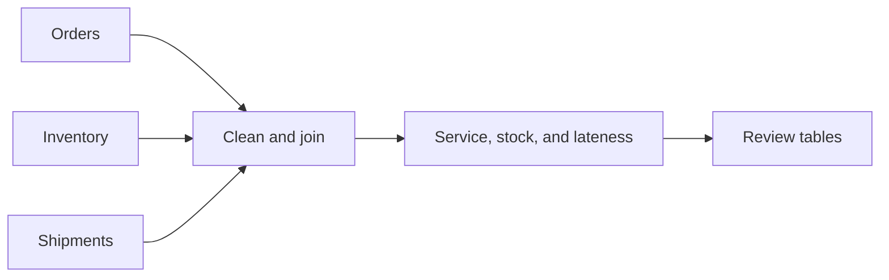
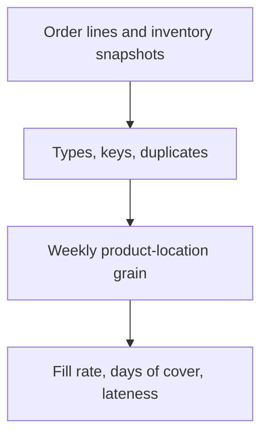

# Supply chain analytics

Orders, inventory, and shipments usually live in three exports that nobody joins until something stockouts. This project is the join, plus the summaries you would actually bring to an operations review: what is late, what is overstocked, and which lane is doing it.



## The grain

A row in the review table is a product at a location over a week, not a raw order line. That is the grain where a stockout and a late truck can be seen together. Finer grains are kept for drill-down. The notebooks and scripts under the repo build that rollup from the raw extracts.



## Run it

```bash
python -m venv .venv && source .venv/bin/activate
pip install -r requirements.txt
```

Point the loader at the extracts. The output is a table per KPI, not a single model score. If a forecast is trained later, it should sit on top of this grain rather than replacing it.

## What this signals

Operations analytics: define the grain, then the metric. The model, if there is one, comes after the table is trustworthy.
